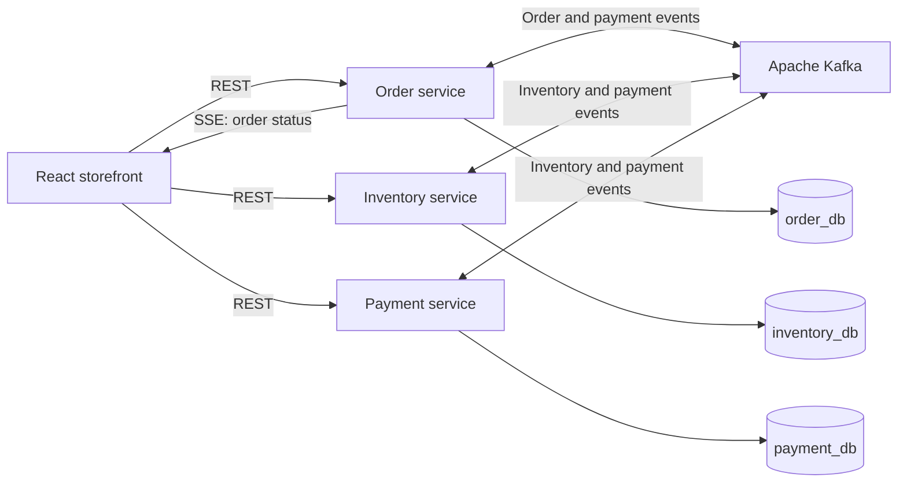

# E-commerce with Kafka

An e-commerce demo exploring an event-driven checkout flow with Spring Boot, Apache Kafka, PostgreSQL, and React. Orders, inventory reservations, and payments are managed by separate services, with Kafka events coordinating the workflow and Server-Sent Events (SSE) updating the browser.

The storefront includes product search, a shopping cart, and checkout with simulated payment outcomes. Stripe Checkout integration is also under development.

## Architecture



Each service owns a separate database in the local PostgreSQL instance. Docker Compose runs PostgreSQL and Kafka; the Java services and frontend run separately.

| Component | Local address | Responsibility |
| --- | --- | --- |
| Frontend | http://localhost:5173 | Product browsing, cart, and checkout |
| Order service | http://localhost:8081 | Orders, customer details, and status events |
| Inventory service | http://localhost:8082 | Products, images, stock, and reservations |
| Payment service | http://localhost:8083 | Mock payments, Stripe sessions, and webhooks |
| PostgreSQL | `localhost:5432` | Service databases |
| Kafka | `localhost:9092` | Events between services |

### Checkout events

1. The order service saves an order and publishes `ORDER_CREATED`.
2. The inventory service checks available quantities. It publishes `INVENTORY_REJECTED` if any item is unavailable, or reserves stock and publishes `INVENTORY_RESERVED`.
3. The payment service creates a pending payment after inventory is reserved and publishes `PAYMENT_PENDING`.
4. A mock payment submission or Stripe webhook updates the payment and publishes `PAYMENT_SUCCEEDED` or `PAYMENT_FAILED`.
5. On success, inventory reservations are confirmed, stock is reduced, and the order service updates the order status. Order status changes reach the frontend through SSE.

Failure compensation is not complete: the order and inventory services do not currently consume `PAYMENT_FAILED`.

## Technology

- **Backend:** Java 25, Spring Boot 4.1.x, Spring Data JPA, Spring Kafka, MapStruct, Lombok, and springdoc OpenAPI.
- **Frontend:** React 19, TypeScript, Vite, Redux Toolkit, TanStack Query, Tailwind CSS, and Stripe React components.
- **Infrastructure:** PostgreSQL 18 and Apache Kafka 4.3.1 in KRaft mode, as configured in Docker Compose.

## Repository layout

```text
ecommerce-frontend/   React storefront
order-service/       Order API and SSE updates
inventory-service/   Product catalogue and inventory reservations
payment-service/     Payment API and Stripe integration
init-db/             PostgreSQL database and schema initialization
docker-compose.yml   Local PostgreSQL and Kafka infrastructure
```

## Run locally

### Prerequisites

- JDK 25, with `JAVA_HOME` configured.
- Node.js 24 and pnpm compatible with the included v9 lockfile.
- Docker with Docker Compose.

Each Java service includes a Maven wrapper; a separate Maven installation is not required. The commands below use PowerShell and start from the repository root unless stated otherwise. On macOS or Linux, use `./mvnw` instead of `.\mvnw.cmd` and your shell's equivalent environment-variable syntax.

### 1. Start infrastructure

```powershell
docker compose up -d
docker compose ps
```

Wait for PostgreSQL and Kafka to report healthy before starting the services. On a fresh PostgreSQL volume, [the initialization script](init-db/01-init-databases.sql) creates `order_db`, `inventory_db`, and `payment_db`, plus the required schemas. The application database username and password are both `ecommerce`.

### 2. Start the backend services

Run each block in a separate terminal.

**Order service:**

```powershell
cd order-service
.\mvnw.cmd spring-boot:run
```

**Inventory service:**

The 20 sample product images are included in [inventory-service/data/product-images](inventory-service/data/product-images/), so no separate download or manual copy is needed after cloning the repository.

```powershell
cd inventory-service
$env:APP_PRODUCT_IMAGES_DIR = Join-Path $PWD.Path 'data/product-images'
.\mvnw.cmd spring-boot:run
```

The inventory service seeds the product catalogue from `src/main/resources/data.sql` after Hibernate initializes its tables. The seed data references the included image filenames. If you keep the images elsewhere, set `APP_PRODUCT_IMAGES_DIR` to that directory instead.

Only the original sample images are included in Git. The service generates small and medium thumbnails on demand; these files and additional uploads are ignored. To add a new sample image to the repository, add its filename to the allowlist in `inventory-service/.gitignore` and update the catalogue seed data. Local image storage is a temporary approach until a better storage solution is introduced.

**Payment service (mock mode):**

```powershell
cd payment-service
$env:APP_PAYMENT_MODE = 'mock'
$env:STRIPE_SECRET_KEY = 'sk_test_mock_placeholder'
$env:STRIPE_WEBHOOK_SECRET = 'whsec_mock_placeholder'
.\mvnw.cmd spring-boot:run
```

The Stripe client and webhook service are initialized even in mock mode, so both configuration values are required at startup. These placeholders are only for mock mode and cannot authenticate Stripe API calls or webhooks.

### 3. Start the frontend

```powershell
cd ecommerce-frontend
if (!(Test-Path .env)) { Copy-Item .env.example .env }
pnpm install --frozen-lockfile
pnpm dev
```

Open http://localhost:5173. The example environment file points to the three local backend services. Restart Vite after changing `.env`.

### 4. Try mock checkout

Browse products, add items to the cart, and submit the checkout contact form. Once inventory is reserved and the payment is pending, select `SUCCEEDED` or `FAILED` in the mock payment form and confirm. The browser redirects to the checkout return page.

Successful payments confirm reservations and reduce stock. Failed payments update the payment record, but currently leave the order status and inventory reservations unchanged.

## Payment configuration

| Variable | Purpose |
| --- | --- |
| `APP_PAYMENT_MODE` | `mock` selects the simulated payment form; use `stripe` for the Stripe form |
| `STRIPE_SECRET_KEY` | Backend Stripe API key; required even in mock mode |
| `STRIPE_WEBHOOK_SECRET` | Backend webhook signing secret; required even in mock mode |
| `STRIPE_CURRENCY` | Payment currency; defaults to `eur` |
| `STRIPE_RETURN_URL` | Defaults to `http://localhost:5173/checkout/return?session_id={CHECKOUT_SESSION_ID}` |
| `VITE_STRIPE_PUBLISHABLE_KEY` | Frontend publishable key in `ecommerce-frontend/.env` |

For Stripe development, replace the mock placeholders with test credentials, set `APP_PAYMENT_MODE=stripe`, and configure webhook delivery to `POST /payments/webhook` on port 8083. The handler accepts `checkout.session.completed`, `checkout.session.async_payment_succeeded`, `checkout.session.async_payment_failed`, and `checkout.session.expired`. Backend secret keys belong in the backend environment, never in `VITE_*` variables.

The Stripe frontend still needs a fix before this path can work: `CheckoutForm.tsx` starts the session request inside `useMemo` but does not return its promise, leaving the provider's `clientSecret` undefined.

## API documentation

Each backend exposes Swagger UI at `/docs` and OpenAPI JSON at `/api-docs`:

- [Order API](http://localhost:8081/docs)
- [Inventory API](http://localhost:8082/docs)
- [Payment API](http://localhost:8083/docs)

Key checkout endpoints:

| Service | Method | Path | Purpose |
| --- | --- | --- | --- |
| Order | POST | `/orders/create` | Create an order |
| Order | GET | `/orders/{orderId}/events` | Subscribe to order status events |
| Payment | GET | `/configuration/payment-mode` | Read the selected payment mode |
| Payment | GET | `/payments?order_id={orderId}` | Find a payment ID for an order |
| Payment | GET | `/payments/{paymentId}/session` | Create or reuse an open Stripe session |
| Payment | GET | `/payments/sessions/{sessionId}` | Look up a payment by session ID |
| Payment | PUT | `/payments/mock/update-payment` | Submit a mock payment outcome |
| Payment | POST | `/payments/webhook` | Receive Stripe webhook events |

## Development checks

From each backend service directory:

```powershell
.\mvnw.cmd test
```

The existing backend tests load the Spring application context and require its configured infrastructure. Payment tests also need the Stripe environment values shown above.

From `ecommerce-frontend`:

```powershell
pnpm lint
pnpm build
```

## Troubleshooting

- **Database or Kafka connection errors:** check `docker compose ps` and `docker compose logs postgres kafka`. The services expect ports 5432 and 9092 on localhost.
- **Missing database or schema:** initialization scripts run only when the PostgreSQL data volume is first created. An existing volume will not rerun them automatically.
- **Missing Stripe property at startup:** set both `STRIPE_SECRET_KEY` and `STRIPE_WEBHOOK_SECRET` in the terminal or IDE environment that launches the payment service.
- **Missing product images:** supply the filenames referenced by the catalogue and verify `APP_PRODUCT_IMAGES_DIR`. Relative paths depend on the service's working directory.
- **Stock remains reserved after a failed or abandoned checkout:** reservation release and expiry are not implemented yet.

Stop the applications with `Ctrl+C` in their terminals, then stop infrastructure with:

```powershell
docker compose down
```

Named volumes preserve PostgreSQL and Kafka data between runs.
